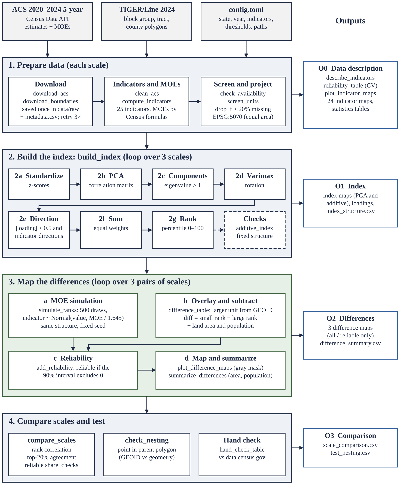

# Difference Mapping Social Vulnerability across Census Units in Colorado

SEES 3050 Geospatial Programming · Final Project · Elif Korkmaz

This project builds a SoVI-based social vulnerability index for Colorado at
three census scales (block groups, tracts, counties) and maps where, and by how
much, a place's vulnerability rank changes when the unit changes. It follows the
unclassed choropleth difference mapping approach of Nelson (2026), reports the
differences by land area and by population, and carries ACS margins of error
through a Monte Carlo simulation so that differences smaller than sampling error
are not read as effects of the unit.



## Files

| File | What it does |
|---|---|
| `config.toml` | All settings: state, years, paths, thresholds, map options, and the 25 indicator definitions |
| `sovi_maup.py` | All functions of the workflow, grouped by step; `run_all()` runs everything |
| `run_analysis.ipynb` | Runs the same steps one at a time and shows the tables and maps |
| `environment.yml` | Python libraries needed |
| `docs/make_workflow.py`, `docs/workflow.png` | Script that draws the workflow diagram, and the diagram |
| `docs/Elif_Korkmaz_CV.pdf` | Author's CV |
| `data/raw/` | Downloads, saved once and never edited (created by the code) |
| `data/processed/` | Difference tables and simulated ranks (created by the code) |
| `outputs/maps/`, `outputs/tables/` | Figures and tables (created by the code) |
| `logs/run.log` | Messages and warnings from each run |

`data/`, `outputs/`, and `logs/` are not in the repository; the code creates them.
`data/raw/metadata.csv` records every download (file, source, status), including failed ones.

## Data

Both datasets are public and are downloaded by the code.

* **American Community Survey (ACS) 2020–2024 5-year Detailed Tables**, U.S. Census
  Bureau, through the Census Data API (https://api.census.gov/data/2024/acs/acs5).
  Estimates and margins of error at the block group, tract, and county levels.
* **TIGER/Line Shapefiles 2024**, U.S. Census Bureau
  (https://www2.census.gov/geo/tiger/TIGER2024/). Block group, tract, and county polygons.

## How to run

The project is in the `Final Project` folder of the course repository. Run all
commands from inside that folder:
```
git clone https://github.com/geog3050/ekorkmaz.git
cd "ekorkmaz/Final Project"
```

1. Install Miniconda or Anaconda, then create and activate the environment:
   ```
   conda env create -f environment.yml
   conda activate sees3050-final
   ```
2. Get a free Census API key at https://api.census.gov/data/key_signup.html and
   save it in a file named `census_api_key.txt` in this folder (one line).
   This file is listed in `.gitignore` and is not pushed to GitHub.
   You can also set the `CENSUS_API_KEY` environment variable instead.
3. Run the workflow in one of two ways:
   * **Notebook:** open `run_analysis.ipynb` (VS Code or Jupyter), select the
     `sees3050-final` kernel, and run all cells.
   * **Script:** from this folder, run `python sovi_maup.py`.

The first run downloads the data (about 5 minutes; block groups are requested
county by county). Later runs read the saved files in `data/raw` and take about
3 minutes. To run another state or ACS year, change the `[study]` section of
`config.toml` and the `zoom_bbox` in `[maps]`.

## Libraries

pandas, numpy, geopandas, pyogrio, matplotlib, requests (see `environment.yml`).
Python 3.11 or newer is needed (the code uses `tomllib`).

## Workflow and functions

**Step 1. Prepare data (each scale)**

| Function | Input → Output |
|---|---|
| `load_config` | `config.toml` → settings dictionary (checks required sections) |
| `download_variable_labels` | settings → official label of every ACS variable used |
| `download_acs` | settings, scale, API key → raw estimates and MOEs (saved in `data/raw`) |
| `download_boundaries` | settings, scale → polygons in EPSG:5070 |
| `clean_acs` | raw table → estimates and MOEs, with ACS special codes set to missing |
| `compute_indicators` | estimates, MOEs → 25 indicators and their MOEs (Census formulas) |
| `check_availability` | all scales → share missing per indicator and scale; drops indicators > 20% missing |
| `screen_units` | indicators → units with population and no missing values |
| `reliability_table` | indicators, MOEs → median CV and share with CV > 40% |
| `prepare_data` | runs Step 1 for every scale and checks the ACS–polygon join |

**O0. Describe the data:** `describe_indicators`, `plot_indicator_maps`, `plot_correlation`.

**Step 2. Build the index (each scale)**

| Function | Input → Output |
|---|---|
| `build_index` | indicators → index score and percentile rank, plus the structure (2a z-scores, 2b PCA, 2c components with eigenvalue > 1, 2d varimax, 2e component direction from loadings ≥ 0.5 and expected indicator directions, 2f equal-weight sum, 2g percentile rank) |
| `varimax` | loadings → rotated loadings |
| `additive_index` | indicators → sum of direction-adjusted z-scores (robustness check) |
| `build_all_indices` | all scales → PCA, additive, and fixed-structure indices |
| `structure_table`, `plot_index_maps` | summary of components; index maps |

**Step 3. Map the differences (each pair of scales)**

| Function | Input → Output |
|---|---|
| `simulate_ranks`, `run_simulations` | indicators, MOEs, structure → 500 simulated ranks per unit |
| `difference_table` | ranks of two scales → small rank − large rank, land area, population |
| `add_reliability` | simulated ranks → 90% interval of each difference; reliable if it excludes 0 |
| `summarize_differences` | differences → statistics and shares of area and population |
| `plot_difference_maps`, `plot_difference_histograms` | differences → maps and histograms |

**Step 4. Compare scales:** `compare_scales` (rank correlation, top-20% agreement,
reliable share, and the difference maps repeated with the additive and
fixed-structure indices).

## Tests

* `check_nesting`: a point inside every smaller polygon must fall inside the larger
  polygon named by its GEOID. Result: 100% for all three pairs
  (`outputs/tables/test_nesting.csv`).
* `hand_check_table`: shows (in the notebook) the raw ACS values and the computed
  values of four indicators for two random units per scale. The poverty rate of
  block group 080050074002 was looked up on data.census.gov (table C17002) and
  recomputed by hand; it matched the code (16.52%).

## Main outputs

| File | Content |
|---|---|
| `outputs/maps/indicators/*.png` | Each indicator at the three scales (O0) |
| `outputs/maps/index_maps_index.png` | PCA-based index, percentile rank at each scale (O1) |
| `outputs/maps/difference_*.png` | Difference maps; right panels show reliable differences only (O2) |
| `outputs/maps/difference_histograms.png` | Distribution of differences by land area and population (O2) |
| `outputs/tables/difference_summary.csv` | Nelson-style statistics for each pair (O2) |
| `outputs/tables/scale_comparison.csv` | Agreement between scales and robustness checks (O3) |

## About the author

I am Elif Korkmaz, a PhD student in Geography at the University of Iowa,
School of Earth, Environment, and Sustainability (since 2025). My research
looks at how social vulnerability interacts with multiple hazards, using
spatial analysis and GIScience methods. This project is a first step for that
work: before I use a social vulnerability index in hazard studies, I want to
know how much the index depends on the census unit it is built on.

**Background.** M.S. in Earth System Science (Middle East Technical University,
2024), with a thesis on socio-spatial vulnerability to energy poverty, published
in *Energy and Buildings* (2025). B.S. in City and Regional Planning with a minor
in GIS and Remote Sensing (METU, 2021). Before the PhD, I worked as a project
consultant on environmental, climate, and water projects, where I built spatial
datasets and GIS maps. At Iowa, I designed a database and web application (the
CHEEC Portal) as a research assistant, and I now teach discussion sections of
SEES:1070.

**Interests.** Social vulnerability, multi-hazard risk, census data uncertainty
and the MAUP, spatial analysis, GIScience.

**CV.** [docs/Elif_Korkmaz_CV.pdf](docs/Elif_Korkmaz_CV.pdf)

**Contact.** [ekorkmaz@uiowa.edu](mailto:ekorkmaz@uiowa.edu) · [LinkedIn](https://www.linkedin.com/in/elif-korkmaz-2a16b3176/)

## Reference

Nelson, J. K. (2026). A difference mapping approach for detecting cartographic
effects of the modifiable areal unit problem. *KN – Journal of Cartography and
Geographic Information*.

## Use of AI tools

Claude (Anthropic) was used to help write and test the code and the
documentation. All design decisions, the checks of the results, and the
interpretation are my own, and I reviewed and can explain every function.
